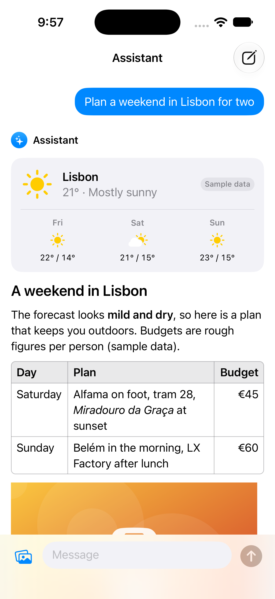

# Chat Sample

A chat app that uses TranscriptKit for the assistant's text and mixes that text
with native SwiftUI parts: a weather card, a Swift Charts chart, a photo strip
with a full-screen viewer, source cards, an action bar and suggestion chips.

There is no model behind it. Answers are scripts (`Assistant.swift`) played out
over time the way a model streams text and calls tools: a status row while a
"tool" runs, then a native card, then more streamed Markdown.

## Running it

Open `ChatSample.xcodeproj` and run the ChatSample scheme on an iOS 17+
simulator. For a device, pick your team under Signing & Capabilities first (it
has only been run in the simulator so far). It uses the TranscriptKit package
two folders up, so keep the repository layout as it is.

Launch arguments, for trying it from the command line or a scheme:

| Argument | What it does |
| --- | --- |
| `-prompt "Analyze our quarterly sales"` | Sends a prompt a second after launch |
| `-attachSample 1` | Attaches a generated photo to that prompt |
| `-startEmpty 1` | Starts with no conversation, on the prompt suggestions |
| `-slow 1` | Streams four times slower, to watch the text come in |

Prompts the scripts know: "Plan a weekend in Lisbon", "Where should we eat?",
"What did the team ship?", "Analyze our quarterly sales", anything with a photo attached, and the follow-ups each answer
suggests ("Make it cheaper", "Add a day trip to Sintra", "Why did Q3 jump?",
"Suggest a caption"). Anything else gets a short list of these.

## What to look at

- **Which parts are TranscriptKit.** Each TranscriptKit view has a yellow
  tint and a dashed outline, so you can tell it from the native SwiftUI parts
  around it. The highlighter button at the top left turns this off and on.
- **Streaming between native parts.** An answer is a list of parts
  (`Part.Content`): text segments and native views, in order. Each text
  segment is its own `TranscriptText`.
- **Text beside other views.** "Where should we eat?" and the Sintra answer
  put TranscriptKit text in `HStack`s (`SideBySide.swift`): restaurant rows
  with a photo on the left and a save button on the right, a tip whose text
  streams in beside an icon, two text columns compared side by side, and a
  timeline of times beside text. The text view takes the width its
  neighbors leave and is as tall as its text at that width, so rows grow with
  it, also while it streams. It has no narrower "ideal" width: it fills its
  space even when the text is short, so it can't size a bubble to its text.
- **Custom tags and their shapes.** "What did the team ship?" uses the
  app's own tags (`SampleTags.swift`): `<mention id="ana">` is a tinted pill
  with an outline and a link the app handles (tap one, padding included),
  `<mark>` is a hand-drawn highlighter stroke, `<status value="late">` is a
  solid pill whose color comes from the attribute, and `<kbd>` replaces the
  built-in one with an outlined key cap. `<todo>` draws a zigzag with a
  shape the app defines itself (`Zigzag`), and `<hl>` a soft highlighter
  band (`SoftUnderline`, also the app's own) that starts a little left of
  the text where a wrapped line begins: shapes may draw up to 12 points
  outside the text view. When an `<hl>` tag finishes arriving, its band
  sweeps in and each letter jumps as the band reaches it and springs back
  (`Boing`, an animation the app defines); `-slow 1` makes it easier to
  watch. Pills get room from the tag's
  `padding`; their shapes are made when the text is laid out, so they stream
  in with the text. Every stream and document in the app is parsed with these
  tags; a tag the app doesn't define shows as written.
- **Streaming stays out of SwiftUI.** Chunks go straight to a
  `TranscriptStream`; nothing SwiftUI observes changes per chunk
  (`TextSegment` in `Model.swift`). When a segment finishes it becomes a
  `TranscriptDocument`, and the same `TranscriptText` keeps showing it, so
  SwiftUI updates the existing text view instead of replacing it.
- **Markdown images through the app's loader.** `SampleImages.loader` serves
  only `sample://` addresses: generated photos and the pictures you attach. An
  `https://` image in the text shows its alt text instead. The library never
  fetches anything itself; whether to fetch a model's image URLs (which could
  send data to that server) is the app's call. Picked photos are redrawn
  upright and at most 1,200 pixels on the longer side (`SampleImages.attach`): the loader
  hands the text view a `CGImage`, which has no orientation.
- **Stop and Regenerate.** Stop keeps what has arrived (an unfinished code
  block or table is shown as it is) and marks the answer as stopped.
- **Links.** Links in the text, email links, `[1]`-style reference links and
  the source cards all go through one `openURL` handler, which opens web links
  in an in-app Safari sheet.
- **Everything else in the text:** headings, tables, task lists, quotes, code
  blocks, strikethrough, numbered lists, selection with handles and the
  loupe, dark mode.

## Files

| File | Contents |
| --- | --- |
| `ChatSampleApp.swift` | App entry and launch arguments |
| `Model.swift` | `TextSegment`, `Message`, `Part` and the sample data types |
| `Assistant.swift` | The scripts and `Conversation`, which plays them |
| `ChatView.swift` | The scroll view, composer, photo picker, toast and Safari sheet |
| `MessageViews.swift` | User bubbles, assistant messages, the text view style, action bar, chips |
| `Cards.swift` | Status row, weather card, chart, photo strip and viewer, sources |
| `SideBySide.swift` | Text beside other views: tip, restaurant rows, comparison, timeline |
| `SampleImages.swift` | The image loader and the generated pictures |
| `SampleTags.swift` | The custom tags and how they look |

## Tradeoffs and known limits

- **Selection stops at each text segment.** A selection can't run across a
  native card or into another message, because each segment is its own view.
  Copy in the action bar copies the whole answer's Markdown instead.
- **A plain `VStack`, not a `LazyVStack`.** In a scroll view anchored at the
  bottom, a lazy stack stopped drawing once an answer started to grow (iOS 27
  simulator). A plain stack builds every message, which is fine at this size;
  a long-lived chat would want a list that recycles.
- **The chart takes taps, not drags.** `chartXSelection` wants a press and
  drag, which the scroll view takes first, so a tap picks a bar instead.
- **Sample data.** The forecast, figures and links (all on example.com) are
  made up.
