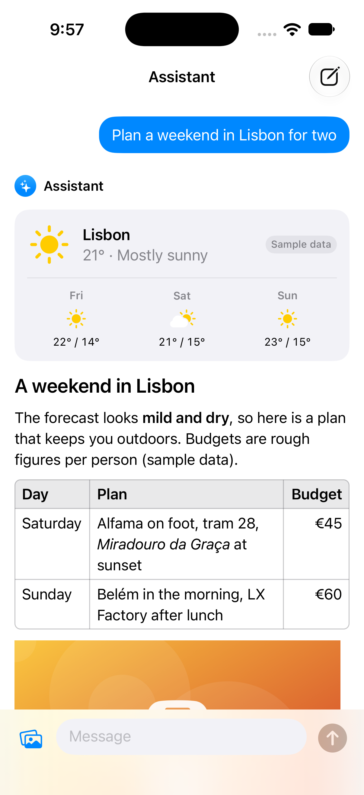

# TranscriptKit

A native Markdown renderer for streamed text on iOS, such as a chat model's answers. It parses Markdown as it arrives,
lays it out with Core Text and draws it in one selectable text view. Parsing and layout run off the main thread, so
text streaming in at hundreds of characters a second doesn't make scrolling stutter.



## Features

- **Streaming first.** Chunks can split anywhere, even inside a Markdown marker. Text that could still turn into
  markup is held back for a character or two, so what is on screen almost never changes style or shrinks.
- **Off the main thread.** Each frame's chunks are parsed on a background queue and laid out on another. Only the
  blocks that changed are laid out again, and the line being written is drawn on the layout queue into a surface.
  The main thread installs the result and redraws what changed.
- **One selectable document.** The whole text is one view with the system's selection handles, loupe and edit menu,
  and a selection can run from one block to the next: across headings, paragraphs, lists and code blocks.
- **Markdown:**
  - headings, paragraphs, emphasis, strikethrough and inline code;
  - nested lists, task lists and quotes;
  - fenced and indented code blocks and tables;
  - links, bare URLs and email addresses, and reference links;
  - images, drawn by a loader your app provides;
  - HTML entities and a few HTML tags.
- **Custom tags.** Define tags such as `<mention id="ana">@Ana</mention>` and how they look: font traits, colours, a
  link, padding, and shapes drawn behind or over the text. Pills and underlines (solid, dashed, dotted, wavy,
  marker) are built in, and you can draw shapes of your own, and animate a tag's letters and shapes when it
  finishes arriving.
- **SwiftUI and UIKit.** `TranscriptText` for SwiftUI, `TranscriptTextView` for UIKit.

## Requirements

iOS 17 or later, Swift 6 (Xcode 16 or later). The parser and document model also build on macOS 14, which is where
the tests run.

## Installation

Add the package with Swift Package Manager:

```swift
dependencies: [
    .package(url: "https://github.com/servercimen/TranscriptKit.git", branch: "main"),
]
```

There are no tagged releases yet. The API may still change.

## Usage

Stream text into a `TranscriptStream` and show it with `TranscriptText`:

```swift
import SwiftUI
import TranscriptKit

struct AnswerView: View {
    @State private var stream = TranscriptStream()

    var body: some View {
        ScrollView {
            TranscriptText(stream: stream)
                .padding()
        }
        .task {
            for await chunk in model.answer() {   // your source of text
                stream.append(chunk)
            }
            stream.finish()
        }
    }
}
```

`append` only stores the text. Once per frame, everything appended since the last frame is parsed and laid out in
the background and goes straight to the view, without a SwiftUI update. SwiftUI is involved only when the text's
height changes. `finish()` shows any text that was held back in case it turned into markup.

For text that is already complete, parse it once and pass the document:

```swift
let document = MarkdownStreamParser.document(from: markdown)
TranscriptText(document, style: style)
```

### Custom tags

```swift
let tags = [
    TranscriptTag("mention") { attributes in
        TranscriptDecoration(
            traits: .bold,
            foreground: TranscriptColor(UIColor.systemIndigo),
            link: attributes["id"].map { "myapp://person/\($0)" },
            padding: 5,
            shapes: [.pill(fill: TranscriptColor(UIColor.systemIndigo.withAlphaComponent(0.1)),
                           border: TranscriptColor(UIColor.systemIndigo.withAlphaComponent(0.45)))]
        )
    },
    TranscriptTag("mark", TranscriptDecoration(
        shapes: [.underline(.marker, color: TranscriptColor(UIColor.systemYellow.withAlphaComponent(0.6)))]
    )),
]
let stream = TranscriptStream(tags: tags)
```

Tags the app doesn't define show as written. For a shape of your own, implement `TranscriptShapeRecipe`. It returns
paths for each line the tag's text is on and may draw a little outside the text, up to 12 points to the sides,
past the view's edges. The chat sample has two such shapes, `Zigzag` and `SoftUnderline`, in
[`SampleTags.swift`](Examples/ChatSample/ChatSample/SampleTags.swift).

### Animated tags

A tag can also play an animation when its closing tag arrives in streamed text. Implement
`TranscriptAnimationRecipe`: from the tag's fragments, which then list their glyphs, it returns curves over time for
each glyph (offset, scale, rotation) and paths to reveal or fade in.

```swift
struct Hop: TranscriptAnimationRecipe {
    func animation(for fragments: [TranscriptFragment]) -> TranscriptAnimation {
        var animation = TranscriptAnimation()
        for (line, fragment) in fragments.enumerated() {
            for (index, glyph) in fragment.glyphs.enumerated() {
                // One letter after the other, a few points up and back.
                let start = Double(glyph.index) * 0.03
                animation.glyphs.append(.init(fragment: line, glyph: index, offsetY: .spring(peak: -4, start: start)))
            }
        }
        return animation
    }
}

TranscriptTag("hop", TranscriptDecoration(animation: .custom(Hop())))
```

Until its closing tag arrives, an animated tag shows its text without its shapes. The view then draws the tag's
glyphs and the animation's paths on Core Animation layers above the text, and draws the tag as usual again when
the animation ends, so the last frame should match that: glyphs back in place, paths fully shown. Only tags that
close while text streams in are animated, not earlier messages. Turn animations off with `animatesTags` on the view
or `.animatesTags(false)` on `TranscriptText`; with Reduce Motion on, nothing is animated. The chat sample's `Boing`
sweeps a highlighter band in under the text while each letter jumps as the band reaches it.

By default a tag's animation plays as soon as its closing tag arrives. To wait, set a timing: a tag that has closed
then waits, showing its text without its shapes, until every condition holds.

```swift
// Not before the tag is on screen and the whole answer is in:
TranscriptText(stream: stream)
    .tagAnimationTiming([.whenVisible, .afterStreamFinishes])

// Only when the app says so: each time `revealCount` changes, waiting tags play.
TranscriptText(stream: stream)
    .tagAnimationTiming(.whenRequested)
    .playTagAnimations(trigger: revealCount)
```

In UIKit, set `tagAnimationTiming` on `TranscriptTextView` and call `playTagAnimations()`. A tag that is still
waiting when it can no longer play (Reduce Motion turned on, animations turned off, the view leaving its window, a
new document) is shown as it ends up.

### Images

Images in the text show their alt text unless you provide a loader. The library never fetches anything itself, so
whether to load a URL from a model's answer is up to your app:

```swift
TranscriptText(stream: stream)
    .imageLoader { image in await myImageCache.cgImage(for: image.source) }
```

### Selection

The text is selectable by default. Turn selection off for text inside a view that reacts to taps, such as a card or a
list row. A tap that is not on a link then goes to that view, and links still open:

```swift
TranscriptText(document)
    .selectable(false)
```

In UIKit, set `isSelectable` on `TranscriptTextView`.

### Styling

`TranscriptStyle` sets the body size, line, block and list spacing, indents, padding and the maximum image height.

To match an app's own type scale, give it fonts. Each `TranscriptFont` has a font name (nil for the system font), a
size, a weight for the system font, letter spacing and a line height. Headings take one font for each level, and
levels past the end use the last one. Inline code uses the code font's design at 0.9 times the size of the text
around it:

```swift
var style = TranscriptStyle()
style.bodyFont = TranscriptFont(size: 16, weight: 0, letterSpacing: -0.2, lineHeight: 24)
style.headingFonts = [
    TranscriptFont(size: 28, weight: 0.4, lineHeight: 34),
    TranscriptFont(size: 22, weight: 0.3, lineHeight: 28),
    TranscriptFont(size: 18, weight: 0.3, lineHeight: 24),
]
style.codeFont = TranscriptFont(name: "Menlo-Regular", size: 14, lineHeight: 20)
style.scalesWithDynamicType = true
```

A line height replaces `lineSpacing` for that kind of text, and a line is never less tall than its font needs. With
`scalesWithDynamicType`, `TranscriptText` scales every text size and line height as `UIFontMetrics` scales body text.
With `TranscriptTextView`, set `style.scaled(for: traitCollection.preferredContentSizeCategory)` yourself.

It also sets the colors. Each one is a `TranscriptColor`, with a value for light and one for dark appearance, so the
text can be drawn off the main thread. A color that is nil uses the system color shown here:

```swift
var style = TranscriptStyle()
style.textColor = TranscriptColor(UIColor.label)                     // the text
style.linkColor = TranscriptColor(UIColor.systemIndigo)              // links and their underlines
style.codeBackgroundColor = TranscriptColor(UIColor.secondarySystemFill)  // code blocks, table headers
style.accentColor = TranscriptColor(UIColor.tertiaryLabel)           // quote bars, rules, table lines
```

### Reading the selection

`onSelectionChange` tells the app when the selection changes. The range is in the document's flat UTF-16 offset
space, and it is nil when nothing is selected any more. `selectsAllWhenShown()` selects all of the text, with the
selection handles shown, when the view comes on screen:

```swift
TranscriptText(document)
    .selectsAllWhenShown()
    .onSelectionChange { range in
        if range == nil { dismiss() }    // the person tapped the selection away
    }
```

In UIKit, use `onSelectionChange`, `selectedRange` and `selectsAllWhenShown` on `TranscriptTextView`.

## In this repository

| Folder | Contents |
| --- | --- |
| `Sources/TranscriptKit` | The library |
| `Tests/TranscriptKitTests` | Unit, layout and pixel tests: `swift test` |
| [`Examples/ChatSample`](Examples/ChatSample) | A chat app that mixes streamed TranscriptKit text with native SwiftUI views (cards, charts, photos), custom tags and text beside other views |
| `Demo` | A small app for trying selection and streaming |
| `Benchmark` | A benchmark app and script that compare TranscriptKit with other renderers on the simulator and on phones, with results and notes |
| [`Docs/architecture.html`](Docs/architecture.html) | How the parser, layout and drawing work, and the measurements behind the design; download it and open it in a browser |

## License

MIT. See [LICENSE](LICENSE).
